# zBoxTUI

A DCUI-style TUI for Debian, inspired by **VMware ESXi DCUI** layout and
**XCP-ng `xsconsole`**-style ncurses host menus (see [TRADEMARKS.md](TRADEMARKS.md)).
Drops onto a virtual console as the operator interface for a `zbox` deployment:
configure the hostname, manage the root password, edit network settings, install
curated package sets, inspect live system stats, and run quick connectivity
tests — all from the terminal, no shell required.

Built on [Textual](https://textual.textualize.io/) (Python 3.11+), ships with six
colour themes — **[Catppuccin Mocha](https://catppuccin.com/palette/)**
(`catppuccin-mocha`, default; palette from [catppuccin.com](https://catppuccin.com/))
— and exposes a small plugin API so new menu entries can be added by dropping a
single `.py` file into `src/zboxtui/plugins/`.

> **Work in progress.** This repository is an early appliance integration preview.
> Console installation on zBox images is handled by
> [`packer-zbox`](../packer-zbox/files/zbox-zboxtui-setup.sh) (`/sbin/zbox-zboxtui-setup.sh`).
> This project was built using Claude and Cursor; see the disclaimer in the repo history
> and [TRADEMARKS.md](TRADEMARKS.md) for third-party marks.

## Screenshots

All captures use the default **Catppuccin Mocha** theme (`COLORTERM=truecolor`).
Regenerate with `uv run python scripts/capture_readme_screenshots.py` — the script
clears `NO_COLOR` if set, otherwise Textual exports flat grey SVGs. **Whenever you
change a visible UI element** (dialogs, dashboard, menu, packages picker, themes),
re-run the capture script so `docs/screenshots/` stays in sync with the README.

### Dashboard (live metrics off)

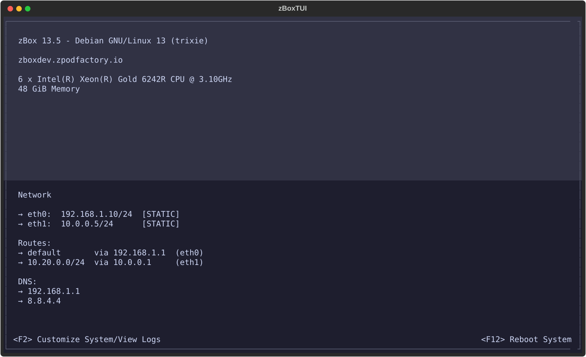

**Live dashboard info** disabled in **Configure Settings** (`display_live_information = false`).
The header lists CPU model and total memory as plain text; there are no CPU/MEM
usage bars or storage panel. The network block uses the full width of the lower area. Each interface shows
`ip/cidr` with a `[STATIC]`, `[DHCP]`, or `[UNMANAGED]` tag; default route and
Routes and DNS use short bulleted sections below the interface list.

### Dashboard (live metrics on)

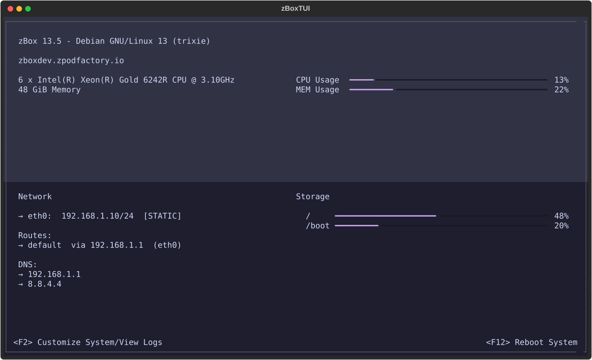

Same view with **Live dashboard info** turned on (default in `app.conf`). The right
column shows CPU/MEM usage bars and a storage panel; values refresh every few seconds
along with the network interface list.

### Login (F2) and Main Menu

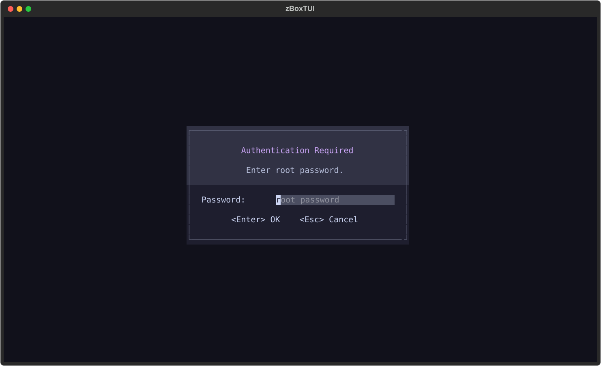

Press **F2** on the dashboard, enter the root password (verified via PAM through
`su -c true root`), and the customization menu opens:

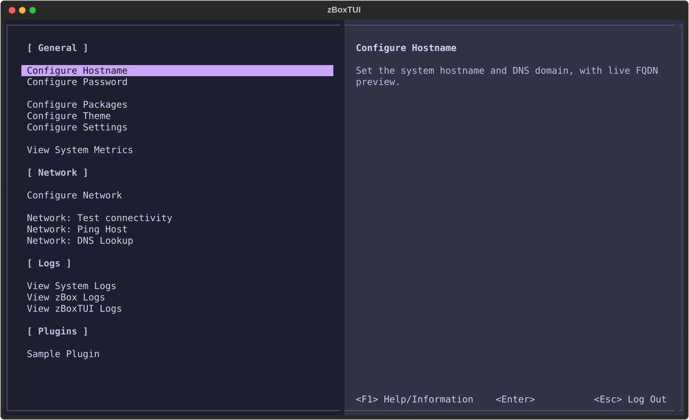

Menu sections: **General**, **Network**, **Logs**, and **Plugins** (from
`src/zboxtui/plugins/`). **F1** opens About on the menu screen. **Esc** / **q**
returns to the dashboard (login session stays active). **F8** exits the app after
login.

### Configure Hostname

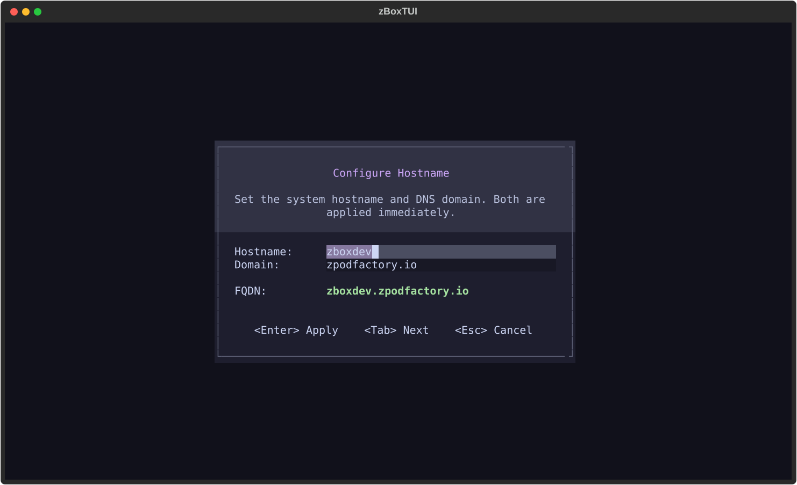

Sets the kernel hostname (`hostnamectl set-hostname …`) and patches the
`127.0.1.1` line in `/etc/hosts` so `hostname -f` returns the FQDN.

### Configure Network

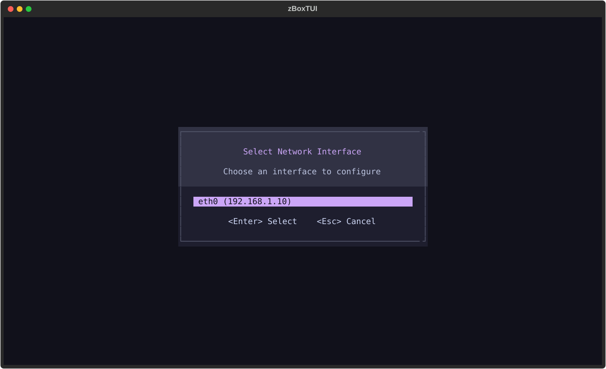

Pick a physical interface, then edit IPv4 address, gateway, and DNS for that
interface (example: **eth0**).

**Static** configuration (editable fields; dashboard shows `ip/cidr` with
`[STATIC]` on the interface line):

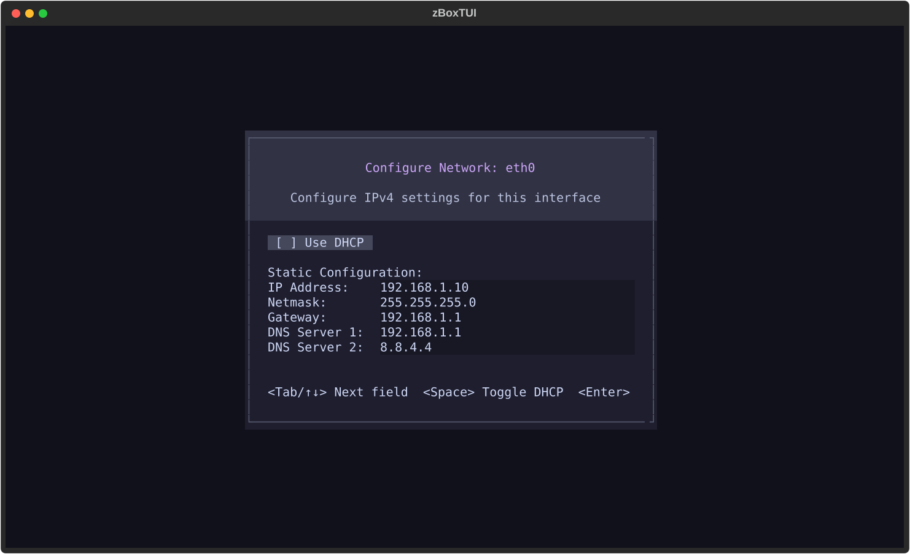

**DHCP** (simulated lease + DNS from dnsmasq `resolv.conf`; dashboard appends
`[DHCP]` on the interface line):

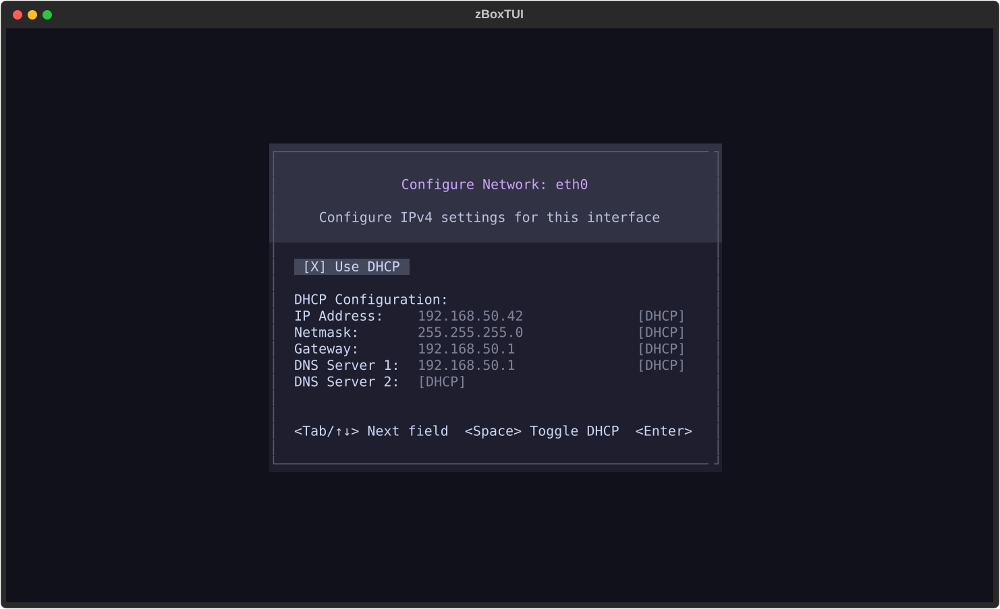

Dashboard network block validation (same simulated values):

| Mode | Interface line | Routing (below interfaces) |
|------|----------------|------------------------------|
| Static | `eth0` + `eth1` lines, `Routes:` (default + `10.20.0.0/24 via 10.0.0.1 (eth1)`), `DNS:` |
| DHCP | `eth0:  192.168.50.42/24  [DHCP]` | `default via … (eth0)`, one DNS per line |

VPN/tunnel interfaces (not in `/etc/network/interfaces`) are tagged `[UNMANAGED]`:

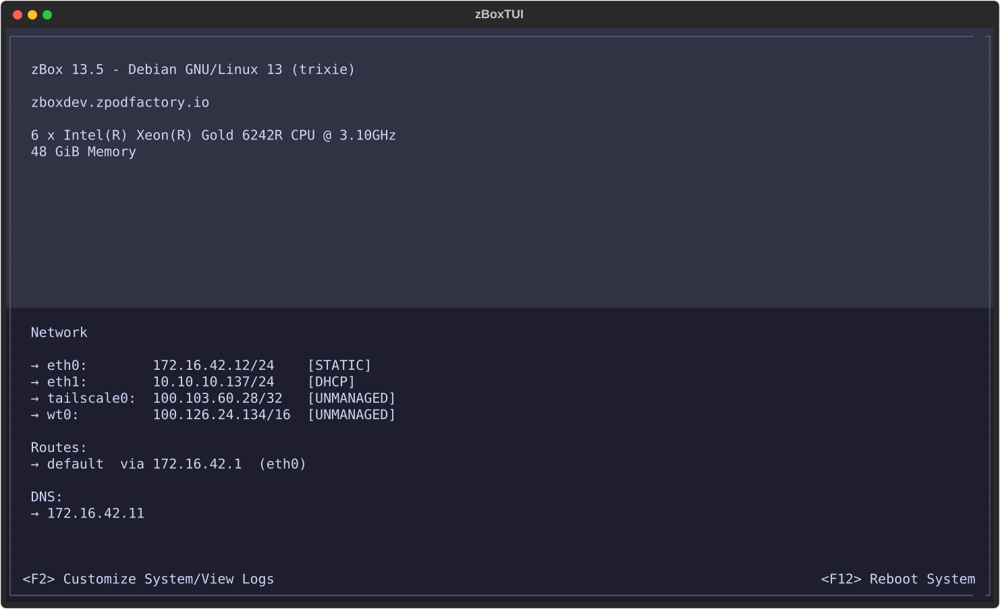

Example: **eth0** / **eth1** plus **tailscale0** (`100.103.60.28/32`) and **wt0**
(`100.126.24.134/16`) on the same host.

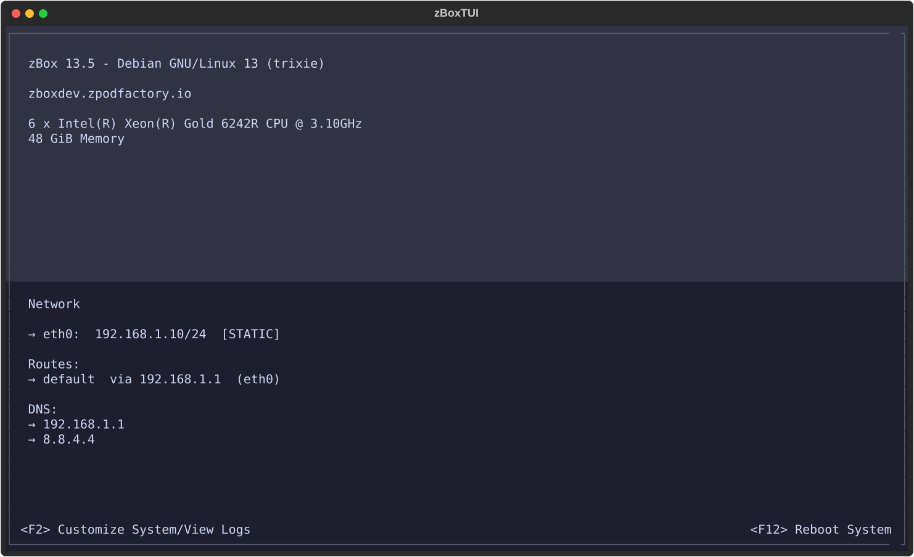

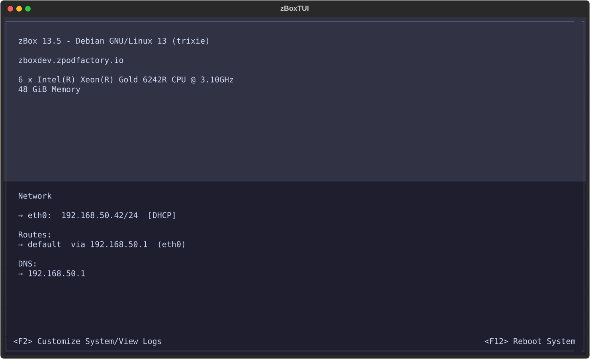

### Configure Packages

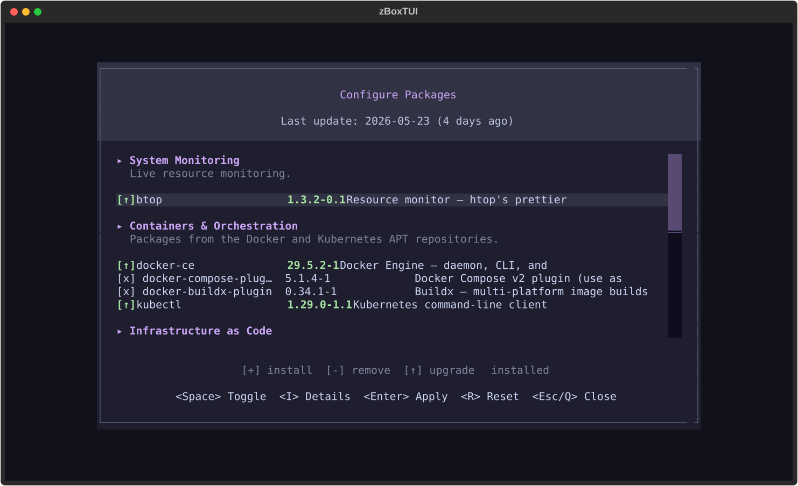

Curated groups from `zbox-packages.json` with install/upgrade/remove checkboxes.
Upgrades show the target version in green (pre-checked `[↑]`) so **Enter**
applies pending updates.

### Configure Theme

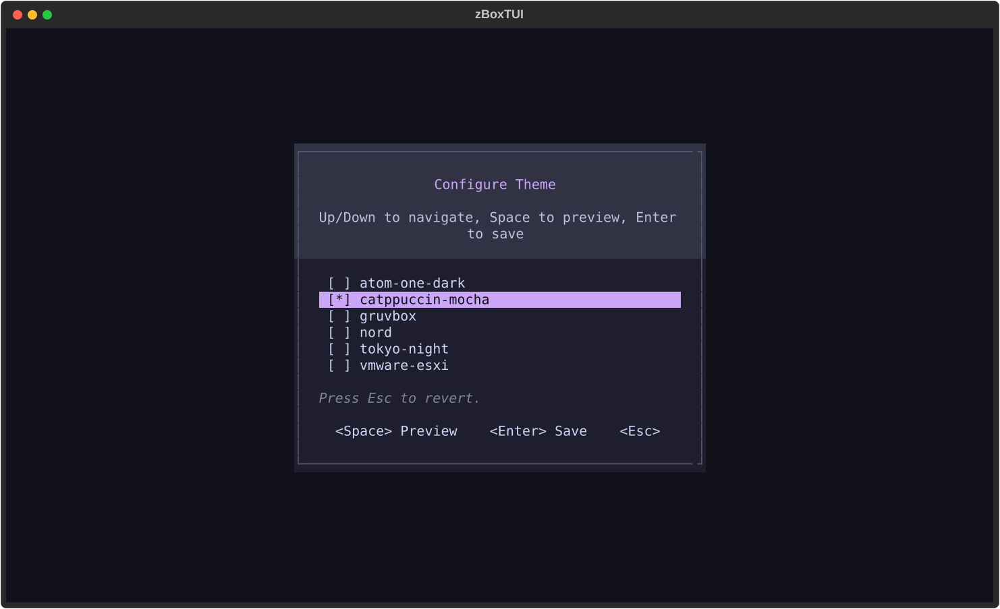

Switch between built-in Textual themes without editing `app.conf` by hand.

### Configure Settings

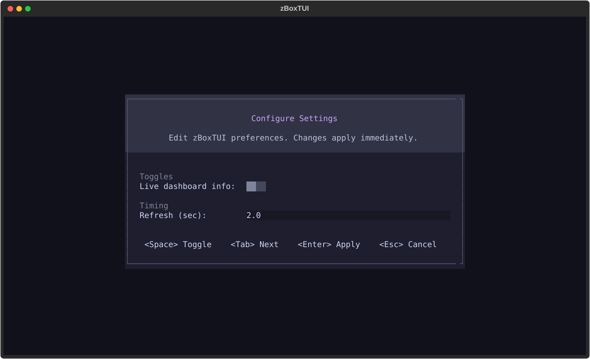

Toggles live dashboard metrics and sets the dashboard refresh interval.

### Test Network Connectivity

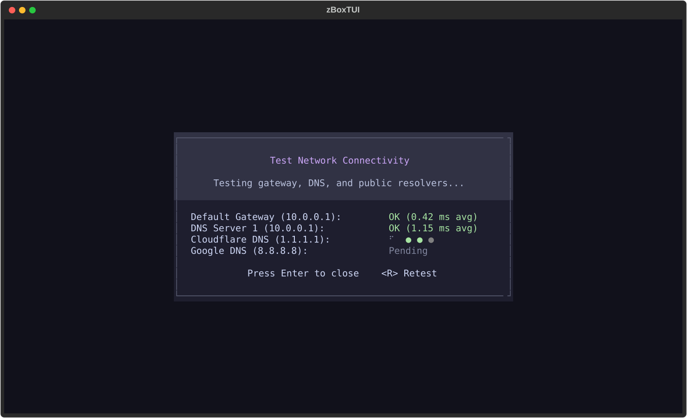

Pings the default gateway, DNS servers, and public resolvers.

### View System Metrics

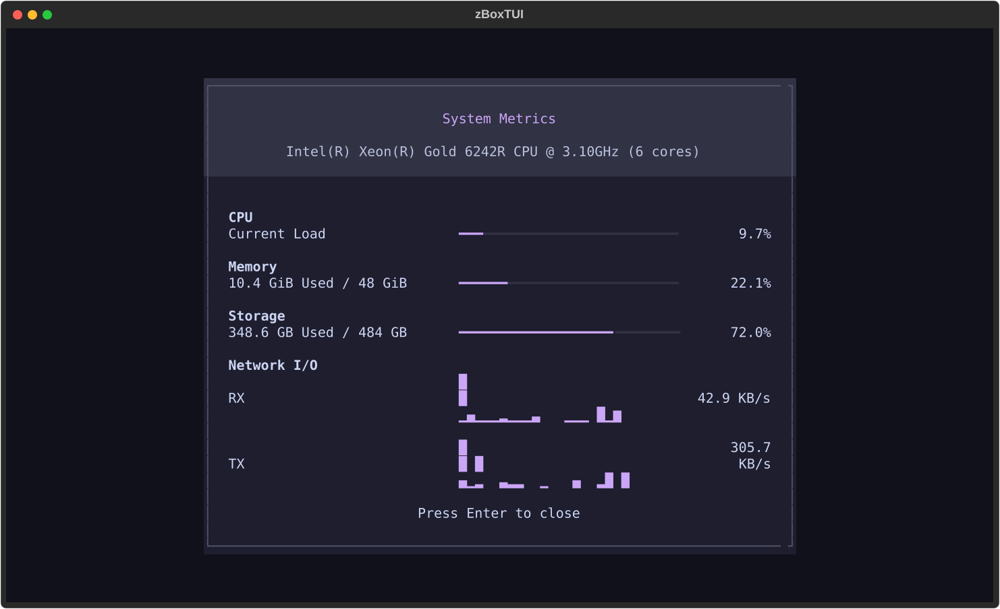

Live CPU, memory, storage, and per-interface network I/O sparklines (sampled over
~20 seconds in the capture script).

### View zBoxTUI Logs

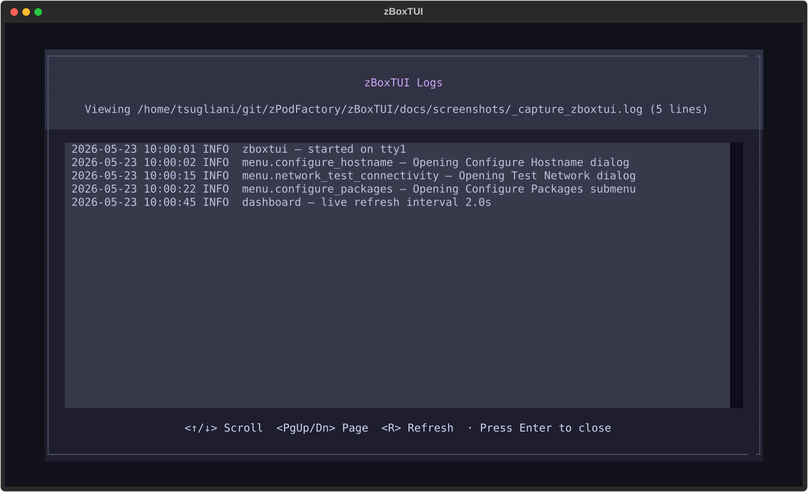

Tails the configured `log_file` from `app.conf`.

## Quickstart

```bash
# Install dependencies (uses uv — https://docs.astral.sh/uv/)
uv sync

# Run the TUI
uv run zboxtui

# Force a specific theme for this run
uv run zboxtui --theme vmware-esxi

# Print a sample config to stdout
uv run zboxtui --generate-config

# Use a non-default config file
uv run zboxtui --config /path/to/app.conf

# Save SVG snapshots of every screen visited
uv run zboxtui --debug-svg
```

## Configuration

The config file is searched, first hit wins:

1. `--config <path>` on the CLI.
2. `$ZBOXTUI_CONFIG`.
3. `~/.config/zboxtui/app.conf` (`$XDG_CONFIG_HOME` honoured).
4. `/etc/zboxtui/app.conf`.

`uv run zboxtui --generate-config` prints a fully commented sample (same content as
[`packaging/app.conf.sample`](packaging/app.conf.sample)). Highlights:

```ini
[general]
log_file = /var/log/zboxtui.log
log_level = INFO

[dashboard]
display_live_information = true
refresh_interval_seconds = 2.0

[network]
test_default_target = 1.1.1.1
dns_test_default_target = example.com

[packages]
catalog_url = https://raw.githubusercontent.com/zPodFactory/zBoxTUI/main/zbox-packages.json

[theme]
name = catppuccin-mocha
```

Optional: copy `zbox-packages.json` to `/etc/zboxtui/packages.json` and set
`catalog_url = file:///etc/zboxtui/packages.json` for an air-gapped catalog.

## Themes

| Name | Notes |
|------|--------|
| **`catppuccin-mocha`** | **Default.** [Catppuccin Mocha palette](https://catppuccin.com/palette/). |
| `vmware-esxi` | Yellow/grey DCUI-style approximation (see [TRADEMARKS.md](TRADEMARKS.md)). |
| `nord`, `gruvbox`, `tokyo-night`, `atom-one-dark` | Community palettes; not vendor-affiliated. |

Set `name` under `[theme]` in `app.conf`, or pass `--theme <name>` on the CLI.

## Architecture

```
src/zboxtui/
├── __main__.py                  # CLI entry (argparse + init_config + init_logging)
├── app.py                       # ZBoxTUI(App) — themes, screens, menu dispatch
├── plugin_loader.py             # discover_plugins() — globs plugins/*.py
│
├── core/                        # Permanent, built-in surface
│   ├── themes.py                # 6 Textual Theme objects
│   ├── screens/
│   │   ├── dashboard.py         # Home screen (F2 → login, F12 → reboot)
│   │   └── menu.py              # Sectioned menu (General/Network/Logs + plugins)
│   ├── widgets/                 # DCUIMenu / DCUIHeader / DCUIFooter / dialog kit
│   ├── utils/                   # config.py, logging.py, system.py
│   └── menu_items/              # Built-in menu handlers (see __init__.py)
│
└── plugins/                     # Optional extensions ([ Plugins ] section only)
    └── 99_sample_plugin.py
```

### Application flow

1. `__main__.py` parses CLI args, calls `init_config()` and `init_logging()`,
   then imports and runs `ZBoxTUI`.
2. `ZBoxTUI.__init__` registers every Theme (must happen before any CSS is parsed)
   and applies the configured one.
3. `on_mount` pushes `DashboardScreen`.
4. F2 → `LoginDialog`; PAM auth runs in a background thread (15-minute session,
   extendable when `sudo` still has a cached timestamp).
5. On success, `MenuScreen` rebuilds its menu from `MENU_SECTIONS` plus plugin discovery.
6. Esc/q from the menu returns to the dashboard without clearing the session.
7. `app.handle_menu_action(action_id)` dispatches via the handler registry.
8. F12 from the dashboard runs the reboot flow (login gate + confirmation).

## Plugin authoring

A plugin is a `.py` file in `src/zboxtui/plugins/` whose name does not start with
`_`. Only plugins with `MENU_SECTION = "Plugins"` appear in the menu. Each plugin
must export `MENU_LABEL`, `MENU_DESCRIPTION`, and `show_dialog(app)`.

Copy `99_sample_plugin.py` as a starting point. See `network_ping_host.py` and
`network_dns_lookup.py` under `core/menu_items/` for full dialog examples.

## Production deployment (packer-zbox)

Use **[INSTALL.md](INSTALL.md)** for the full guide. On zBox images, Packer runs:

```bash
sudo /sbin/zbox-zboxtui-setup.sh --enable
```

That script (canonical copy in
[`packer-zbox/files/zbox-zboxtui-setup.sh`](../packer-zbox/files/zbox-zboxtui-setup.sh))
installs kmscon on **tty1** (zBoxTUI) and **tty2** (login shell), clones this repo,
builds the wheel with `uv`, and writes console/kmscon files inline. It only copies
**`packaging/app.conf.sample`** and **`packaging/zboxtui.logrotate`** from the clone.

Revert: `sudo /sbin/zbox-zboxtui-setup.sh --disable`

## Development

```bash
uv sync
uv run ruff check src/ tests/
uv run mypy src/
uv run pytest                    # 229 tests

uv run python scripts/capture_readme_screenshots.py   # docs/screenshots/01–17
```

## Releases

What changed in each version: [GitHub releases](https://github.com/zPodFactory/zBoxTUI/releases)
or [CHANGELOG.md](CHANGELOG.md). Every change gets a line under `[Unreleased]` there, and a
release is one command:

```bash
python3 tools/release.py 0.3.0 --push      # --dry-run first to see the plan
```

It moves the heading, bumps `pyproject.toml` and `uv.lock`, runs the tests, commits, tags
`v0.3.0` and pushes; the tag then runs `.github/workflows/release.yml`, which publishes the
changelog section as the GitHub release note. See [tools/README.md](tools/README.md).

## Trademark notice

VMware, ESXi, XenServer, Citrix, XCP-ng, and related marks belong to their
respective owners. zBoxTUI is inspired by ESXi DCUI and XCP-ng-style host consoles
but is **not** affiliated with any vendor. See [TRADEMARKS.md](TRADEMARKS.md).

## License

MIT License — see [LICENSE](LICENSE).
